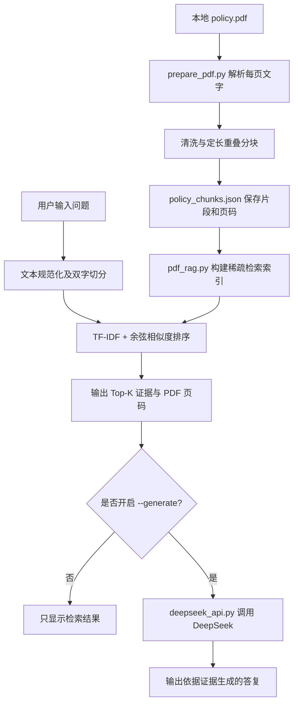

# Insurance RAG Demo｜项目解说与面试讲解

> 项目地址：https://github.com/cold-ai-dev/insurance-rag-demo  
> 文档定位：基于仓库当前 `main` 分支源码编写，用于 GitHub 作品集、复盘学习和技术面试。  
> 项目阶段：**本地命令行原型 / 检索与证据增强问答 Demo**，并非生产级保险业务系统。

---

## 1. 一分钟看懂项目

### 1.1 解决什么问题？

保险产品的条款通常较长，涉及等待期、床位费、续保条件、责任免除等细节。直接让大语言模型凭已有知识回答，容易出现**混淆产品版本、漏看例外条款、回答缺少出处**的问题。

这个 Demo 尝试把流程改为：**先从指定保险资料中找证据，再选择是否让大模型基于证据回答。**

例如，用户问：

> 「等待期多久，有哪些例外？」

系统先查找相关 PDF 片段，展示片段 ID、来源 PDF 页码和匹配分数。如果开启生成模式，才把检索到的片段与问题一起发送给 DeepSeek，要求基于证据回答并引用出处。

### 1.2 当前已经实现了什么？

| 能力 | 当前状态 | 对应文件 |
|---|---|---|
| 手写保险条款的最小检索原型 | 已实现 | `insurance_from_zero.py` |
| PDF 文本提取、清洗、分块 | 已实现 | `prepare_pdf.py` |
| 文本片段附带来源与页码 | 已实现 | `prepare_pdf.py` |
| 中文双字切分 + TF-IDF 稀疏向量检索 | 已实现 | `pdf_rag.py` |
| Top-K 相关片段输出 | 已实现 | `pdf_rag.py` |
| 基于人工标注题目的离线检索评测 | 已实现 | `pdf_rag.py`、`pdf_eval.json` |
| 可选调用 DeepSeek 生成回答 | 已实现代码入口；运行依赖可用 API | `pdf_rag.py`、`deepseek_api.py` |
| Embedding 模型语义向量化 | **未实现** | — |
| FAISS / Chroma / Milvus 向量数据库 | **未实现** | — |
| BM25、Reranker、混合检索 | **未实现** | — |
| Web 前端、用户权限、生产部署 | **未实现** | — |

**重要定位：** 虽然文件名中有 `RAG`，但当前检索器使用的是**词项统计得到的稀疏向量**，不是通过 Embedding 模型得到的语义向量。严格介绍时，建议说“基于 TF-IDF 的轻量级检索增强问答原型”。

---

## 2. 从整体架构看一次问答

这个项目分为两个阶段：**文档准备**和**在线提问**。二者不应混为一谈。



**两条线路：**

- **默认检索模式**：只找片段，不调用大模型。适合调试检索命中情况，也无需 API Key。
- **生成模式**：先检索，后调用 DeepSeek。比直接把问题扔给模型多了一个“提供原始证据”的步骤。

### 2.1 为什么要分成两个阶段？

PDF 文本不必在用户每提一个问题时重新解析。先执行 `prepare_pdf.py` 产生可复用的片段，再执行 `pdf_rag.py` 检索，能把“资料处理”和“问答检索”分开，便于定位错误。

不过，**当前 `pdf_rag.py` 会在每次启动时重新读取片段并计算词项权重**，尚未将检索索引持久化为专门的数据库或索引文件。

---

## 3. 代码目录与每个文件的职责

根据当前公开仓库，根目录主要包含：

```text
insurance-rag-demo/
├── insurance_from_zero.py   # 最初的手写条款检索与小规模评测
├── prepare_pdf.py           # PDF -> 清洗文本 + 分块 JSON
├── pdf_rag.py               # PDF 片段检索、评测、命令行入口
├── deepseek_api.py          # 可选的 DeepSeek API 请求封装
├── pdf_eval.json            # 检索评测题集及标准证据 ID
└── .gitignore               # 忽略 .env 和 __pycache__
```

**注意：** 当前 GitHub 仓库未公开 `policy.pdf`、`policy_chunks.json`、`policy_clean.txt` 或 `requirements.txt`。这些不是可直接从仓库运行得到的现成文件；其中后两者由 `prepare_pdf.py` 根据本地 PDF 生成。

### 3.1 `insurance_from_zero.py`：理解检索原理的最初版本

- 在代码里直接存放少量示例条款，含 `product`（产品版本）、`ref`（条款引用）和 `text`（内容）。
- 用相邻两个字符组成的集合（bigrams）比较问题和条款文本的重合程度。
- 根据产品版本筛选候选条款，避免不同产品的条款直接混在一起。
- `--eval` 模式内置简单测试题，并观察 Top-K 对 Hit、Recall、Precision 的影响。
- 默认问答模式**打印证据和一个准备好的 Prompt**；该脚本本身不调用 DeepSeek。

这是“先在很少的数据上把检索问题想清楚”的教学原型。

### 3.2 `prepare_pdf.py`：把 PDF 转成可检索片段

使用 `pypdf.PdfReader` 按页提取可复制文字，然后：

1. 合并异常空格、减少过多空行。
2. 每页按约 **400 个字符**切分，前后片段保留 **60 个字符重叠**。
3. 对每条片段记录 `id`、`source`、`page`、`text`。
4. 写出 `policy_clean.txt`（清洗后的全文）和 `policy_chunks.json`（结构化分块数据）。

输出数据的一条记录形如：

```json
{
  "id": "policy-p2-1",
  "source": "policy.pdf",
  "page": 2,
  "text": "此处为从保单 PDF 第 2 页提取的片段内容……"
}
```

以上文本为**结构示例**，不代表某份真实保单条款。

**设计原因：** 保留页码与片段 ID，让检索结果可以回到原始材料核对，而不是只显示一段没有出处的 AI 回答。

**当前限制：** 分块采用定长字符切割；复杂表格、扫描件、双栏排版可能提取不完整，且同一条款可能被截断。脚本没有 OCR，也没有按条款标题、语义或版面结构切分。

### 3.3 `pdf_rag.py`：检索与评测的核心

这是项目当前最核心的文件。它的检索流程为：

```text
读取 policy_chunks.json
       ↓
把片段和问题规范化、拆分为相邻双字词项
       ↓
统计 TF 与 IDF，形成稀疏向量
       ↓
计算问题与每条片段的余弦相似度
       ↓
按分数降序排序，返回 Top-K 条证据
```

几个关键概念：

- **Bigrams**：将连续字符两两组合。它实现简单，但对不同表达方式、同义词的理解有限。
- **TF**：某个词项在当前片段出现的频率。
- **IDF**：降低大量片段中都出现的常见词项的影响，提高相对稀有词项的区分度。
- **稀疏向量**：只记录出现过的词项及其权重，维度是词项，不是神经网络 Embedding 模型生成的语义特征。
- **余弦相似度**：衡量问题与文档片段的加权词项重合程度。这里通过归一化向量的点积计算。
- **Top-K**：只选分数最高的 K 条片段，以控制提供给模型的证据数量。

当前代码还包含一个针对演示问题的固定同义表达替换：

```text
住院住宿费 → 床位费
```

它说明业务术语统一的重要性，但**目前只覆盖个别预设表达**，不能视为通用语义理解。

### 3.4 `deepseek_api.py`：只在需要时调用大模型

- 从系统环境变量或本地 `.env` 读取 `DEEPSEEK_API_KEY`、`DEEPSEEK_MODEL`。
- 通过 HTTP 请求调用 DeepSeek 的聊天接口。
- 把 `question` 和已检索的 `evidence` 一起发送。
- 系统提示要求：仅依据证据回答、附片段 ID 与 PDF 页码、证据不足时说明缺失信息、个案赔付由人工核定。
- 对鉴权失败、余额问题、限流、网络错误及异常响应进行基础报错处理。

**边界：** Prompt 的引用要求是一种约束，**不能保证模型每句话都正确引用或完全不会幻觉**。代码里尚未加入生成后引用校验或事实一致性自动评测。

### 3.5 `pdf_eval.json`：人工标注的测试题

当前题集覆盖等待期、病房床位费、续保、既往症、事故通知等问题，另含**跨多个条款的问题**与**资料范围外的问题**。每一道可回答题配置 `gold`：预期被检索到的片段 ID。

例如：

```json
{
  "question": "等待期多久，有哪些例外？",
  "gold": ["policy-p2-1", "policy-p2-2"]
}
```

这意味着项目已经有**离线评测意识**：不仅要看模型回答得像不像，还要验证正确证据有没有被找出来。

---

## 4. 一次实际检索是如何执行的？

以提问“等待期多久，有哪些例外？”为例：

**第一步：处理用户问题。** `pdf_rag.py` 对问题进行文本规范化和相邻字符切分，得到若干词项。

**第二步：计算相关性。** 将问题转换成与 PDF 片段一致的 TF-IDF 权重表示，逐条计算相似度。

**第三步：选择证据。** 按分数选前 3 条（默认 `--k 3`），输出每条对应的 `id`、`source`、`page`、`score` 和正文。

**第四步：决定是否生成。** 默认到此结束；加 `--generate` 时，把选中的证据交给 DeepSeek，并要求回答附出处。

**为什么不是直接向大模型提问？** 因为相似但不同的保单条款可能有不同规则，提供指定资料的检索证据，可以让回答更容易核验。它并不替代人工审核。

---

## 5. 如何复现：从零运行

> 以下命令根据仓库源码整理，**不是已在本环境成功运行的记录**。由于仓库未包含 `policy.pdf`，需要先准备一份**有权使用、可公开或脱敏的 PDF**。如涉及原工作单位资料，不要上传内部保单、客户信息或受保人信息。

### 5.1 准备环境

建议安装 Python 3，并在项目目录打开终端：

```bash
python -m venv .venv
```

Windows PowerShell：

```powershell
.\.venv\Scripts\Activate.ps1
```

macOS / Linux：

```bash
source .venv/bin/activate
```

安装 PDF 处理依赖：

```bash
python -m pip install pypdf
```

当前检索、评测、DeepSeek HTTP 请求的其他依赖主要使用 Python 标准库；仓库里尚无 `requirements.txt` 可直接统一安装。

### 5.2 放入 PDF 并生成片段

将文档命名为 `policy.pdf`，放在脚本同级目录，然后执行：

```bash
python prepare_pdf.py
```

预期会生成：

```text
policy_clean.txt
policy_chunks.json
```

先检查 `policy_clean.txt` 是否乱码、漏页，确认 `policy_chunks.json` 中页码与内容是否对应。**这一步决定后续检索质量。**

### 5.3 只做检索，不调用模型

```bash
python pdf_rag.py "等待期多久，有哪些例外？" --k 3
```

检查返回的片段 ID、PDF 页码、匹配分数和条款内容是否正确。

### 5.4 运行离线评测

```bash
python pdf_rag.py --eval --k 3
```

**注意：** 仓库提供的 `pdf_eval.json` 是针对原来特定 `policy.pdf` 的片段编号标注的。如果换了 PDF，或分块方式改变，`gold` ID 可能失效。必须重新人工标注后才能得到有意义的评测结果；程序也会检查部分 ID 不匹配的情况。

### 5.5 可选：开启 DeepSeek 回答

在项目根目录创建**不提交到 GitHub**的 `.env`：

```dotenv
DEEPSEEK_API_KEY=填写你自己的密钥
DEEPSEEK_MODEL=填写当前账户可调用的模型名
```

再运行：

```bash
python pdf_rag.py "等待期多久，有哪些例外？" --k 3 --generate
```

`deepseek_api.py` 有代码内默认模型配置，但模型可用性以你所用 API 服务的实际支持情况为准。不要把真实 API Key 写进演示文档、截图或提交记录。

### 5.6 体验最初的手写条款原型

```bash
python insurance_from_zero.py --eval
python insurance_from_zero.py
```

第一个命令执行内置评测；第二个命令在终端输入产品版本和客户问题，然后打印证据与 Prompt。它不依赖 PDF，也不发起 LLM 请求。

---

## 6. 评测设计：为什么不只看“回答像不像对”？

当前的评测对象主要是**检索阶段**，不是模型最终回答质量。

| 指标 | 如何理解 | 示例 |
|---|---|---|
| Hit@K | 前 K 条中有没有至少一条正确证据 | 需要两条证据，只找到一条也算 Hit |
| Recall@K | 所有应找到的正确证据中，实际找到了多少 | 应找 2 条，找到了 1 条，即 50% |
| Precision@K | 前 K 个返回位置中，有多少属于标注的正确证据 | K=3，正确 1 条，按代码口径为 1/3 |
| 范围外问题检测 | 对无对应条款的问题是否返回空候选 | 提问其他领域的问题，理想情况不乱返回 |

**结合代码的两个观察：**

1. 代码中的 Precision@K 使用固定 `K` 做分母；即使实际返回不足 K 条，也按 K 计算。它属于特定实现口径，汇报指标时要说明。
2. 当前检索只要相似度大于 0 就可能返回片段，**尚未设置可调的最低相关性阈值**。因此遇到资料外的问题时，可能产生无关候选；不能宣称已实现可靠的“拒答判断”。

建议后续同时评测生成阶段的**答案是否有原文支持、引用是否准确、是否遗漏限定条件、证据不足时是否明确拒答**。

---

## 7. 当前 Demo 的技术边界与改进方向

| 当前不足 | 为什么重要 | 推荐改进顺序 |
|---|---|---|
| 双字 + TF-IDF 检索理解同义词有限 | 用户换一种问法时可能漏检 | 先补术语表，再接 Embedding 检索 |
| 定长切分可能打断完整条款 | 等待期规则和例外可能分离 | 依据标题、条款、页码进行结构化分块 |
| 没有专用向量数据库 | 数据扩大后检索管理不方便 | 接入 FAISS / Chroma 等作为实验 |
| 无重排序和混合检索 | 相关候选顺序可能不理想 | 比较关键词、Dense、Hybrid、Rerank |
| 缺少稳定的相关性阈值 | 资料外问题也可能取回无关内容 | 引入阈值与拒答测试集 |
| 仅评测检索，不评测最终回答 | 证据对也可能答错 | 增加回答忠实度和引用一致性评测 |
| 本地脚本，无服务接口与权限控制 | 尚不能对多用户交付 | 后续用 FastAPI 包装，补日志与鉴权 |
| PDF 解析能力有限 | 扫描、表格等复杂版式容易失真 | 增加版面提取、人工校验与必要 OCR |

建议学习路线（**未来计划，非已实现功能**）：


更高级的方向是将保单产品版本、条款编号、适用条件、例外规定等做成结构化字段，结合 RAG 检索。这样可以减少**不同版本混检**与**例外条件遗漏**的风险。

---

## 8. 面试怎么介绍：真实、有重点、不夸大

### 8.1 60 秒项目介绍

> 我最近自己做了一个保险条款 RAG 原理验证项目，并把代码上传到了 GitHub。这个项目针对保险条款比较长、不同产品版本规则容易混淆、AI 回答需要有依据的问题。
>
> 技术上，我先用 Python 和 pypdf 解析 PDF，按页清洗和分块，保留片段 ID 与页码。检索部分采用中文双字切分和 TF-IDF 稀疏向量，通过余弦相似度返回 Top-K 条证据；在此基础上可以选择调用 DeepSeek，让模型仅依据检索证据回答。
>
> 我还给检索模块设计了人工标注的测试题，使用 Hit@K、Recall@K、Precision@K 观察检索质量。这让我意识到 RAG 的关键不只是调用大模型，而是知识的准确提取、检索命中和证据可追溯。
>
> 目前这是一个轻量级 Demo，下一步准备接入 Embedding 检索、元数据过滤、Rerank，以及完整的回答质量评测。

### 8.2 面试官常问的五个问题

**Q1：你用的是什么向量数据库？**  
A：目前没有接入专用向量数据库。项目将 PDF 片段保存为 JSON，检索阶段即时构建 TF-IDF 稀疏向量并计算余弦相似度。Embedding + 向量数据库是计划中的下一步。

**Q2：为什么设置 Chunk overlap？**  
A：为了降低一个句子或条款恰好被切在片段边界时丢失上下文的风险。当前设置为 400 字符左右的片段、60 字符重叠；但更理想的是按条款结构切分。

**Q3：为什么要返回页码和片段 ID？**  
A：保险条款有细节和例外条件，必须能让使用者回到原始文件核对，避免“模型回答很流畅但没有证据”的情况。

**Q4：你怎么知道检索效果好不好？**  
A：我在 `pdf_eval.json` 中对问题标注了应命中的片段 ID，在离线评测时统计 Hit@K、Recall@K、Precision@K，同时单独检查范围外问题是否乱检索。

**Q5：这个项目能直接用于真实保险核保或理赔吗？**  
A：不能。它是学习型原型，没有经过正式条款核对、完整测试、客户数据权限控制及合规审查。真实核保和理赔仍需按业务规则和专业人员审核流程处理。

### 8.3 简历项目描述（可直接参考）

**保险条款检索增强问答 Demo｜个人项目**

- 使用 Python 与 `pypdf` 实现 PDF 解析、文本清洗和定长分块，保留来源页码与片段 ID，支持条款证据追溯。
- 实现中文双字切分、TF-IDF 稀疏向量及余弦相似度 Top-K 检索，并对接 DeepSeek API 进行可选的证据增强回答。
- 构建人工标注检索测试集，使用 Hit@K、Recall@K、Precision@K 评估结果，分析术语表达差异及跨条款检索问题。

> 这段描述仅基于当前公开代码，不包含尚未实现的 Chroma、Embedding、Reranker 或企业级部署。

---

## 9. 信息安全与作品集说明

- 本项目适合使用**自行编写的模拟条款**或有权公开的文档进行演示。
- 不要把前雇主的内部业务资料、客户个人信息、未公开产品条款、API Key 上传至公开仓库。
- 当前 `.gitignore` 只覆盖 `.env` 和 `__pycache__/`；如准备公开 PDF、评测数据和本地输出，应再次检查是否有保密内容，并根据需要扩展忽略规则。
- 这是技术教学 Demo，不应被描述为已经上线的保险理赔、核保或专业咨询系统。

---

## 10. 源码对照链接

- [项目仓库](https://github.com/cold-ai-dev/insurance-rag-demo)
- [`insurance_from_zero.py`](https://github.com/cold-ai-dev/insurance-rag-demo/blob/main/insurance_from_zero.py)
- [`prepare_pdf.py`](https://github.com/cold-ai-dev/insurance-rag-demo/blob/main/prepare_pdf.py)
- [`pdf_rag.py`](https://github.com/cold-ai-dev/insurance-rag-demo/blob/main/pdf_rag.py)
- [`deepseek_api.py`](https://github.com/cold-ai-dev/insurance-rag-demo/blob/main/deepseek_api.py)
- [`pdf_eval.json`](https://github.com/cold-ai-dev/insurance-rag-demo/blob/main/pdf_eval.json)

**总结：** 项目当前最有价值的部分，是你自己实现并理解了“文档处理 → 证据检索 → 模型生成 → 离线评测”的基本闭环。下一阶段应当在可复现测试的基础上升级检索技术，而不是仅靠增加技术名词包装项目。
